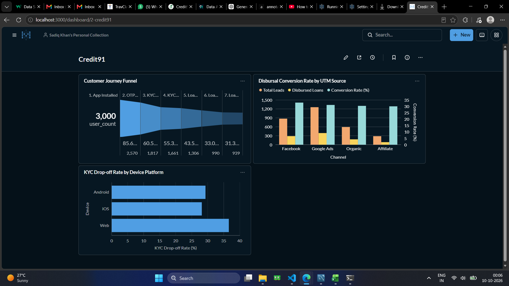

# Digital Lending Customer Journey & Funnel Analytics

## 📌 Executive Summary
An end-to-end analytics workflow simulating a digital credit platform's user acquisition and onboarding pipeline. The project focuses on diagnosing user attrition across multi-stage lending funnels, measuring marketing channel conversion efficiency (attribution), and identifying device-specific onboarding bottlenecks.

---

## 🛠 Tech Stack
* **Database & Querying:** MySQL Workbench (Common Table Expressions, Conditional Aggregations, Window Functions)
* **Business Intelligence:** Metabase (Interactive BI Dashboards, Funnel Visualization)
* **Data Processing & Scripting:** Python (Pandas, NumPy, Datetime pipeline for event simulation)

---

## 📊 Core Business Metrics Tracked
* **Overall Funnel Conversion:** Install-to-Disbursal rate across 3,000 initial users (Final conversion rate: ~31.3%).
* **Drop-off Bottlenecks:** Attrition quantified across 7 key lifecycle events:
  * `App Install` $\rightarrow$ `OTP Verification`
  * `OTP Verification` $\rightarrow$ `KYC Submission`
  * `KYC Submission` $\rightarrow$ `KYC Approval`
  * `KYC Approval` $\rightarrow$ `Loan Application`
  * `Loan Application` $\rightarrow$ `Underwriting Approval`
  * `Loan Approval` $\rightarrow$ `Disbursal Acceptance`
* **Channel Attribution:** Acquisition performance evaluated across Google Ads, Facebook, Organic, and Affiliate channels.
* **Platform Experience Gaps:** Comparative KYC submission drop-off rates across Android, iOS, and Web.

---

## 💡 Key Business Insights
1. **Critical Drop-off at KYC:** The largest operational drop-off occurs between OTP verification and KYC submission (~29.3% attrition), highlighting a need to simplify identity documentation requirements.
2. **Web vs Mobile App Friction:** Web users experience a significantly higher KYC abandonment rate (~36.8%) compared to iOS (~28.1%) and Android (~29.3%), indicating desktop camera capture and document upload hurdles.
3. **Channel Quality:** While Google Ads drives the highest overall lead volume, Facebook and Organic leads deliver competitive end-stage disbursal rates (~31–33%), indicating higher-intent borrower profiles.

---

## 🚀 How to Replicate
1. Run `python scripts/data_generator.py` to produce event logs.
2. Execute SQL scripts in `/sql` inside MySQL to build tables and analytical views.
3. Launch Metabase (`java -jar metabase.jar`), connect to `credit91_analytics`, and assemble the dashboard.